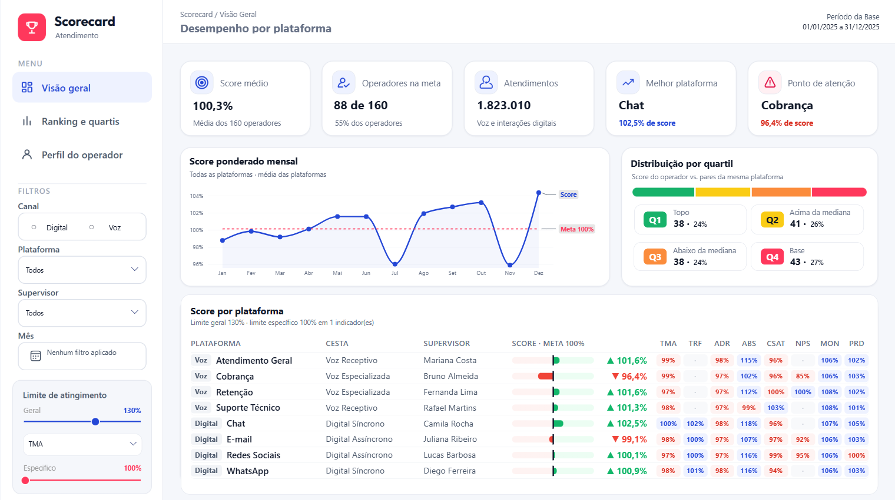

# Dashboard Scorecard Performance

Dashboard em Power BI que acompanha o desempenho de uma operação de atendimento (voz e digital) por meio de um **score ponderado por operador e por plataforma**, com ranking, quartis e perfil individual.

**Dashboard online:** [abrir o dashboard](LINK_DO_DASHBOARD)

> Os dados são **fictícios**: 160 operadores, 8 plataformas e 365 dias de 2025.

<!-- Quando tiver os prints, descomente:

-->

## O que o dashboard mostra

| Página | O que responde |
|---|---|
| **Visão geral** | Como está o score da operação? Quem está acima da meta? Qual plataforma vai melhor e qual precisa de atenção? |
| **Ranking e quartis** | Quem está puxando o score? Em que quartil cada operador está, em geral e em cada indicador? |
| **Perfil do operador** | Como um operador específico se comporta: score, posição, indicadores da cesta, evolução mensal e quartil por indicador. |

Todas as páginas têm filtros de **Canal, Plataforma, Supervisor e Mês** e o controle de **limite de atingimento**. No ranking, o clique com o botão direito numa linha abre o perfil do operador (*drill-through*).

## Como o score é calculado

1. **Indicadores:** TMA, Transferência, Aderência, ABS, CSAT (nota média de 0 a 5), NPS, Monitoria e Produtividade. Cada um é calculado somando os valores antes de dividir, nunca com média de médias.
2. **Atingimento** = realizado ÷ meta. Em TMA e ABS, onde menor é melhor, usa-se meta ÷ realizado.
3. **Limite de atingimento:** o atingimento é limitado a um teto de 100% a 150% (geral ou, para indicadores escolhidos, específico), para que um indicador muito acima da meta não esconda os outros.
4. **Cesta de indicadores:** cada plataforma tem seus indicadores e pesos, e o score é a soma de peso × atingimento. Se um indicador não tem dado no período, o peso é dividido entre os demais.
5. **Meta do score:** 100%.
6. **Quartis:** o operador é comparado com os pares da mesma plataforma. Q1 é o melhor quarto e Q4 o pior, no score geral e em cada indicador.

| Cesta | Plataformas | Indicadores |
|---|---|---|
| Voz Receptivo | Atendimento Geral, Suporte Técnico | núcleo (6) |
| Voz Especializada | Retenção, Cobrança | núcleo + NPS (7) |
| Digital Síncrono | Chat, WhatsApp | núcleo + Transferência (7) |
| Digital Assíncrono | E-mail, Redes Sociais | núcleo + NPS + Transferência (8) |

O núcleo é formado por TMA, Aderência, ABS, CSAT, Monitoria e Produtividade.

## Tecnologias

Power BI (PBIP), DAX, Power Query (M) e o visual HTML Content, com tema e design próprios.
